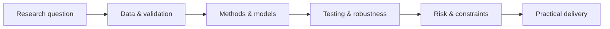

# To Thanh Liem

**Quantitative Finance · Investment Research · Financial Risk**

*A research-led portfolio of financial analytics, systematic investment studies and practical risk-monitoring tools.*

**[Explore the portfolio →](https://toliem212.github.io/)** &nbsp;·&nbsp; [GitHub profile](https://github.com/toliem212)

English / Tiếng Việt &nbsp;·&nbsp; Responsive website &nbsp;·&nbsp; GitHub Pages

---

## Overview

This repository hosts my personal research portfolio. It brings together selected work at the intersection of **financial markets, quantitative methods, data analysis and software development**, with an emphasis on clear methodology and practical applications.

The website presents project objectives, research approaches and links to available live tools or supporting materials. It is a **portfolio**, not a trading service, investment recommendation or claim of live strategy performance.

## Selected work

| Project | Research focus | Explore |
| :--- | :--- | :--- |
| **Financial Risk Surveillance** | Monitoring and analytical workflows covering market, liquidity and financial risk. | [Live application](https://financial-risk-surveillance-1023871252742.asia-southeast1.run.app/) · [Project overview](https://github.com/toliem212/financial-risk-surveillance-portfolio) |
| **Market Risk Dashboard** | Market-risk analytics, sensitivity measures, stress scenarios and visual reporting. | [Live dashboard](https://to-thanh-liem-market-risk.streamlit.app/) · [Repository](https://github.com/toliem212/market-risk-dashboard) |
| **VN30 ETF Quantitative Research** | Systematic ETF investment research, portfolio considerations and empirical evaluation. | [Research portfolio](https://github.com/toliem212/vn30-etf-quant-research-portfolio) |
| **SMA Cross — VN30** | Rule-based equity strategy research, testing assumptions and risk-aware interpretation. | [Research repository](https://github.com/toliem212/sma-cross-vn30) |

*Research projects and demonstrations are presented with their respective assumptions and limitations. Any illustrative results should not be interpreted as verified live trading outcomes.*

## Research approach

My focus is on connecting a well-defined financial question with transparent data processing, appropriate quantitative methods, careful evaluation and outputs that can be used or reviewed.

## Website

- **Format:** Lightweight static site built with HTML, CSS and JavaScript.
- **Languages:** English and Vietnamese.
- **Experience:** Responsive layout for desktop and mobile, accessible navigation and project links.
- **Hosting:** GitHub Pages, published from the `main` branch.
- **Entry point:** [`index.html`](./index.html).

The source in this repository is for the personal portfolio website. Individual research projects may have their own documentation, scope and code-sharing arrangements.

---

**[Visit the portfolio](https://toliem212.github.io/)**

© To Thanh Liem · Quantitative Finance & Research

